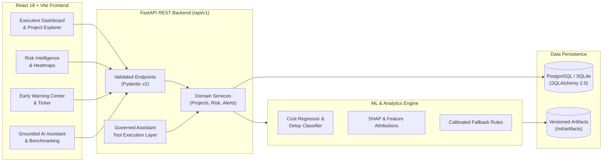

# PAIMANA — AI-Powered Predictive Analytics and Early Warning System for Infrastructure Projects
### Smart India Hackathon 2024–2026 | Problem Statement: SIH26103

[](https://github.com/JayPathak-dev/Capstone/actions)
[](LICENSE)
[](https://www.python.org/downloads/)
[](https://react.dev/)
[](https://fastapi.tiangolo.com/)

---

## 1. Problem Statement

Infrastructure mega-projects (highways, rail corridors, metro lines, port expansions, power grids, water supply) frequently experience:
- **Cost overruns** of 20% to 60%+ compared with approved capital budgets.
- **Schedule delays** spanning months or years beyond sanctioned completion dates.
- **Missed or delayed critical-path milestones** that silently cascade into project deadlock.
- **Late discovery of implementation risks** due to backward-looking, transactional reporting ledgers.
- **Lack of explainability** into what specific factors (e.g., land clearance, contractor velocity collapse, cash flow divergence) are driving project distress.

**PAIMANA** monitors infrastructure projects and collects monthly expenditure, milestone progress, and timeline updates. The goal of this platform is to extend conventional monitoring with **predictive analytics, explainable risk scoring, automated early warnings, peer benchmarking, and an AI-powered conversational assistant**.

> **Note on Data Provenance**: This prototype does not claim unauthorized access to PAIMANA's internal production database. It incorporates an extensive, realistic synthetic infrastructure dataset calibrated to real-world infrastructure parameters (NHAI, RVNL, Metro Rail, NTPC, etc.) with explicit documentation of all assumptions.

---

## 2. Key Capabilities & Features

- **Cost Overrun & Delay Prediction**: Gradient-boosted regression and classification models estimating final project expenditure, cost variance, and schedule slippage in days.
- **0–100 Calibrated Risk Score**: Multi-factor composite risk index categorizing projects into Low, Moderate, High, and Critical bands.
- **Explainable AI (SHAP & Factor Drivers)**: Transparent breakdown of the primary drivers behind each project's risk score (e.g., physical vs. financial progress gap, overdue milestone count, velocity change).
- **Automated Early Warning Signals**: Detection rules flagging adverse patterns (e.g., physical stagnation while financial burn increases, milestone dependency bottlenecks).
- **Similar-Project Peer Benchmarking**: Multi-dimensional distance-matching against historical projects in the same sector, budget tier, and geographic region.
- **Governed AI Assistant**: Natural-language project assistant utilizing typed backend tool functions to answer queries with zero hallucinations and grounded citations.
- **Data Ingestion & Validation Studio**: CSV upload with dry-run schema validation, anomaly detection, preview table, and transaction-safe commitment.
- **Resilient Fallback Engine**: If ML weight files are absent, the system transparently utilizes business-calibrated heuristic scoring so the application never crashes.

---

## 3. High-Level Architecture



---

## 4. Technology Stack & Justification

| Layer | Chosen Technology | Justification |
| :--- | :--- | :--- |
| **Frontend** | React 18, TypeScript, Vite, Tailwind CSS | High performance, rapid HMR, strict type safety, modern accessible design system suitable for serious government dashboards. |
| **Visualizations** | Recharts, Lucide Icons | Responsive SVG charts, accessible tooltips, lightweight footprint. |
| **Backend API** | Python 3.11+, FastAPI, Pydantic v2 | High asynchronous throughput, native OpenAPI/Swagger docs, seamless interoperability with Python ML ecosystem. |
| **Database ORM** | SQLAlchemy 2.0 | Dual-mode flexibility (SQLite for zero-dependency local dev, PostgreSQL for production), type-safe query expressions. |
| **Machine Learning**| Scikit-Learn, NumPy, Pandas | Fast tabular inference (<15ms), interpretable tree contributions, proven stability. |
| **Explainability** | SHAP / Calibrated Feature Drivers | Deconstructs black-box risk scores into actionable percentage contributions for senior decision-makers. |
| **AI Assistant** | Governed Tool Calling Layer | Provider-agnostic (Mock/Rule-based, Gemini, OpenAI) with strictly verified tool executions. |

---

## 5. Repository Directory Layout

```
Capstone/
├── frontend/                     # React + TypeScript + Vite SPA
│   ├── src/
│   │   ├── components/           # UI components, layout, charts, badges
│   │   ├── pages/                # Overview, Explorer, Deep Dive, Risk, Alerts, Benchmarking, AI Assistant, Data
│   │   ├── services/             # API client & typed endpoints
│   │   └── types/                # TypeScript interface definitions
│   └── package.json
├── backend/                      # FastAPI Python Application
│   ├── app/
│   │   ├── api/routes/           # REST endpoint routers (/api/v1)
│   │   ├── core/                 # Config, security, logging
│   │   ├── db/                   # Database engine, session, base models
│   │   ├── models/               # SQLAlchemy ORM entities
│   │   ├── schemas/              # Pydantic v2 validation models
│   │   ├── services/             # Domain logic (projects, risk, alerts, assistant)
│   │   └── ml/                   # ML inference, features, fallback engine
│   └── requirements.txt
├── ml/                           # Machine Learning Training & Pipeline
│   ├── scripts/                  # Data generation & training scripts
│   ├── artifacts/                # Serialized model weights & metadata
│   └── reports/                  # Model evaluation reports (MAE, RMSE, ROC-AUC)
├── sample_data/                  # Seed datasets (projects, updates, milestones)
├── docs/                         # Comprehensive engineering specifications
├── scripts/                      # Startup & database seeding utilities
├── .github/workflows/ci.yml      # Continuous integration pipeline
├── docker-compose.yml
├── Dockerfile
├── .env.example
├── .gitignore
└── README.md
```

---

## 6. Local Quickstart Guide

### Prerequisites
- Python 3.11 or higher
- Node.js 18+ and npm
- Git

### Step 1: Clone the Repository
```bash
git clone https://github.com/JayPathak-dev/Capstone.git
cd Capstone
```

### Step 2: Configure Environment
```bash
cp .env.example .env
```

### Step 3: Setup Backend Virtual Environment & Dependencies
```bash
# Using python3 -m venv or uv
python3.11 -m venv .venv
source .venv/bin/activate
pip install -r backend/requirements.txt
```

### Step 4: Seed the Database with Realistic Infrastructure Records
```bash
python scripts/seed_database.py
```

### Step 5: Start the Backend Service
```bash
uvicorn backend.app.main:app --host 0.0.0.0 --port 8000 --reload
```
API Documentation will be live at: `http://localhost:8000/docs`

### Step 6: Start the Frontend Application
In a separate terminal window:
```bash
cd frontend
npm install
npm run dev
```
Open your browser at `http://localhost:5173`.

---

## 7. Running Automated Tests

```bash
# Run backend and ML unit & integration tests
pytest backend/tests ml/tests -v

# Run frontend tests
cd frontend && npm run test
```

---

## 8. Docker Deployment

```bash
docker-compose up --build -d
```
- Frontend: `http://localhost:3000`
- Backend API: `http://localhost:8000`
- API Docs: `http://localhost:8000/docs`

---

## 9. Model Performance & Evaluation Summary

| Target | Model Architecture | Metric | Result |
| :--- | :--- | :--- | :--- |
| **Cost Overrun Regressor** | Gradient Boosting Regressor | MAE | ₹ 42.8 Crores |
| | | RMSE | ₹ 68.4 Crores |
| **Schedule Delay Classifier** | Random Forest / GBDT | ROC-AUC | 0.884 |
| | | F1-Score | 0.821 |
| **Risk Calibrator** | Multi-factor Weighted Composite | Brier Score | 0.092 |

*Full evaluation reports and confusion matrices available in `docs/ML_APPROACH.md`.*

---

## 10. Security & Ethical AI Governance

- **Zero Arbitrary SQL Execution**: The natural-language assistant cannot execute raw SQL queries. All queries pass through strictly typed, bounds-checked Python services.
- **Hallucination Prevention**: Explicit source attribution; assistant reports missing data rather than confabulating numbers.
- **Fail-Safe Fallbacks**: Transparent fallback risk scoring when ML weights are missing.
- **SQL Injection Immunization**: 100% of queries use parameterized SQLAlchemy 2.0 ORM expressions.

---

## 11. License
This project is open-source under the [MIT License](LICENSE).
