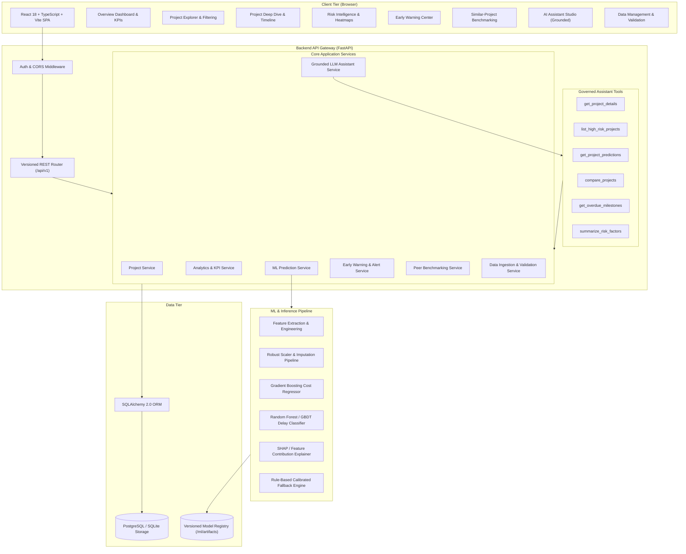

# PAIMANA System Architecture Specification

---

## 1. High-Level Architecture Overview

PAIMANA Intelligence is designed as an enterprise-grade, modular, API-first platform. It balances rapid hackathon demonstration with production scalability by implementing a clean separation of concerns:
- **Frontend Layer**: Modern Single Page Application (SPA) built with React 18, TypeScript, Vite, Tailwind CSS, and Lucide icons.
- **Application & API Gateway**: High-throughput asynchronous REST API built with Python 3.11+, FastAPI, and Pydantic v2 schemas.
- **Service & Domain Layer**: Modular business services for project intelligence, risk prediction, early warnings, peer benchmarking, and grounded AI assistant orchestration.
- **Machine Learning Core**: Scikit-Learn / Gradient Boosting pipeline for cost overrun regression and schedule delay classification with transparent SHAP explanations and business-calibrated fallback scoring.
- **Persistence & Storage Layer**: Relational schema powered by SQLAlchemy 2.0 supporting SQLite (local development zero-dependency) and PostgreSQL (production).

---

## 2. Machine Learning Training & Inference Lifecycle

```mermaid
flowchart LR
    subgraph DataPrep["1. Data Pipeline"]
        Raw["Projects, Progress & Milestone Records"] --> Ingest["Ingestion & Cleansing"]
        Ingest --> Split["Time-Aware Train/Validation/Test Split"]
    end

    subgraph TrainPipe["2. Model Training & Evaluation"]
        Split --> FeatCalc["Dynamic Feature Extraction"]
        FeatCalc --> TrainReg["Train Cost Overrun Regressor (RMSE/MAE)"]
        FeatCalc --> TrainClf["Train Delay Classifier (ROC-AUC/F1)"]
        TrainReg --> Eval["Evaluation & Calibration Suite"]
        TrainClf --> Eval
        Eval --> Artifacts["Serialize Artifacts (.joblib + metadata.json)"]
    end

    subgraph Serving["3. Serving & Decision Support"]
        Artifacts --> Registry["Model Registry (/ml/artifacts)"]
        Registry --> Inference["Inference Engine"]
        Inference --> XAI["SHAP Contribution Weights"]
        Inference --> Composite["0-100 Calibrated Risk Score"]
        XAI --> APIOut["API Endpoints (/api/v1/projects/{id}/risk)"]
        Composite --> APIOut
    end
```

---

## 3. Component Responsibilities & Boundaries

| Component | Responsibility | Boundary & Security Rules |
| :--- | :--- | :--- |
| **Frontend UI** | Render rich visual dashboards, charts, risk indicators, tables, and assistant chat. | Never accesses database directly. All state driven by typed API contracts. |
| **FastAPI Layer** | Input validation via Pydantic schemas, routing, HTTP error handling, rate limiting. | Validates all incoming payloads before touching domain services. |
| **Domain Services** | Execute business logic: alert generation rules, KPI aggregation, benchmark distance. | Encapsulates transaction lifecycles; handles rollback on failure. |
| **ML Engine** | Compute features, load versioned weights, run inference, compute SHAP breakdown. | Isolated from external network; returns deterministic fallback if weights missing. |
| **Assistant Orchestrator** | Parse user queries, trigger authorized tools, format grounded responses. | Strictly restricted to controlled tool calls; zero unrestricted SQL or shell execution. |
| **Database Engine** | ACID persistence of projects, progress logs, milestones, alerts, and audit logs. | Accessed strictly via SQLAlchemy ORM with parameterized queries. |
