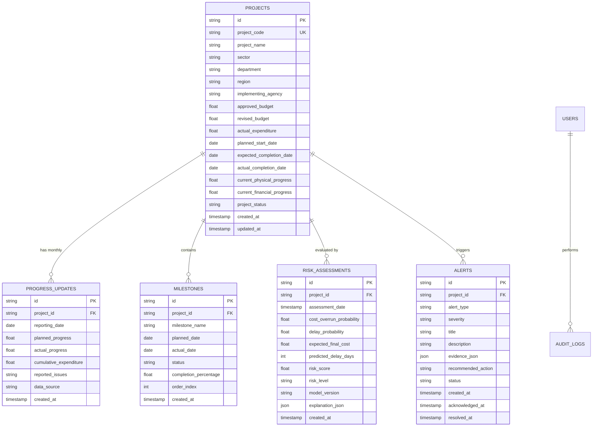

# PAIMANA Data Dictionary & Relational Schema

---

## 1. Entity-Relationship Overview

The platform uses a normalized relational schema with explicit constraints, foreign keys, enumerated statuses, and audit timestamps.

---

## 2. Table Specifications

### 2.1 `projects`
Core master table holding approved infrastructure project sanctions.
- `id` (VARCHAR(36), PK): UUID4 unique identifier.
- `project_code` (VARCHAR(32), UNIQUE, INDEX): Official alphanumeric identifier (e.g., `NHAI-2024-EXP-08`).
- `project_name` (VARCHAR(255)): Official title of the project.
- `sector` (VARCHAR(64), INDEX): Domain (e.g., `Roads & Highways`, `Railways`, `Urban Mass Transit`, `Power & Renewable Energy`, `Water & Sanitation`, `Ports & Shipping`).
- `department` (VARCHAR(128)): Ministry or administrative department.
- `region` (VARCHAR(64), INDEX): Geographic zone / state (e.g., `Northern`, `Western`, `Southern`, `Eastern`, `North-Eastern`).
- `implementing_agency` (VARCHAR(128)): Public sector enterprise or contractor authority (e.g., `NHAI`, `RVNL`, `DMRC`, `NTPC`).
- `approved_budget` (NUMERIC(14, 2)): Original Cabinet/Committee sanctioned cost (in ₹ Crores).
- `revised_budget` (NUMERIC(14, 2), NULLABLE): Revised administrative sanction if cost escalation was approved.
- `actual_expenditure` (NUMERIC(14, 2)): Cumulative payment vouchers booked to date (in ₹ Crores).
- `planned_start_date` (DATE): Sanctioned start date.
- `expected_completion_date` (DATE): Sanctioned completion deadline.
- `actual_completion_date` (DATE, NULLABLE): Date project was officially commissioned.
- `current_physical_progress` (NUMERIC(5, 2)): Weighted physical works completed (0.00% to 100.00%).
- `current_financial_progress` (NUMERIC(5, 2)): Expenditure as percentage of approved budget (0.00% to 100.00%+).
- `project_status` (ENUM): `SANCTIONED`, `IN_PROGRESS`, `STALLED`, `COMPLETED`, `DELAYED`.
- `created_at` (TIMESTAMP WITH TIME ZONE): Record creation time.
- `updated_at` (TIMESTAMP WITH TIME ZONE): Record modification time.

### 2.2 `progress_updates`
Monthly / periodic time-series monitoring updates.
- `id` (VARCHAR(36), PK): UUID4.
- `project_id` (VARCHAR(36), FK -> projects.id, INDEX): Parent project.
- `reporting_date` (DATE, INDEX): End of monthly reporting window (e.g., `2024-03-31`).
- `planned_progress` (NUMERIC(5, 2)): Target planned physical progress curve value at reporting date.
- `actual_progress` (NUMERIC(5, 2)): Recorded ground-truth physical progress at reporting date.
- `cumulative_expenditure` (NUMERIC(14, 2)): Cumulative expenditure booked by reporting date.
- `reported_issues` (TEXT, NULLABLE): Notes on land acquisition, forest clearances, contractor default, etc.
- `data_source` (VARCHAR(64)): Source system (e.g., `PAIMANA_PORTAL`, `FIELD_INSPECTION`, `CONTRACTOR_REPORT`).

### 2.3 `milestones`
Critical path stages and contractual deliverables.
- `id` (VARCHAR(36), PK): UUID4.
- `project_id` (VARCHAR(36), FK -> projects.id, INDEX): Parent project.
- `milestone_name` (VARCHAR(255)): Milestone title (e.g., `Land Acquisition 80% Complete`, `Tunnel Piercing`).
- `planned_date` (DATE): Target completion date.
- `actual_date` (DATE, NULLABLE): Actual completion date.
- `status` (ENUM): `PENDING`, `ON_TRACK`, `DELAYED`, `COMPLETED`, `MISSED`.
- `completion_percentage` (NUMERIC(5, 2)): Completion progress of this specific milestone.
- `order_index` (INTEGER): Chronological sequence in work breakdown structure.

### 2.4 `risk_assessments`
Model evaluation records and explainability diagnostics.
- `id` (VARCHAR(36), PK): UUID4.
- `project_id` (VARCHAR(36), FK -> projects.id, INDEX): Parent project.
- `assessment_date` (TIMESTAMP WITH TIME ZONE, INDEX): Timestamp of model evaluation.
- `cost_overrun_probability` (NUMERIC(4, 3)): Estimated probability [0.000 to 1.000].
- `delay_probability` (NUMERIC(4, 3)): Estimated delay probability [0.000 to 1.000].
- `expected_final_cost` (NUMERIC(14, 2)): Regressed forecast final cost in ₹ Crores.
- `predicted_delay_days` (INTEGER): Forecast slippage in calendar days.
- `risk_score` (NUMERIC(5, 2)): Composite 0.00 to 100.00 calibrated risk index.
- `risk_level` (ENUM): `LOW` (0-29), `MODERATE` (30-49), `HIGH` (50-74), `CRITICAL` (75-100).
- `model_version` (VARCHAR(32)): Artifact version identifier (e.g., `gbdt-cost-v1.2`).
- `explanation_json` (JSON / TEXT): Feature contribution breakdown, SHAP values, and key risk drivers.

### 2.5 `alerts`
Early warning notifications triggered by anomaly rules and ML risk thresholds.
- `id` (VARCHAR(36), PK): UUID4.
- `project_id` (VARCHAR(36), FK -> projects.id, INDEX): Associated project.
- `alert_type` (VARCHAR(64)): Category (`COST_ESCALATION_RISK`, `SCHEDULE_SLIPPAGE`, `PROGRESS_STAGNATION`, `MILESTONE_BREACH`, `FINANCIAL_DISCREPANCY`).
- `severity` (ENUM): `LOW`, `MEDIUM`, `HIGH`, `CRITICAL`.
- `title` (VARCHAR(255)): Concise alert headline.
- `description` (TEXT): Detailed context of what anomaly occurred.
- `evidence_json` (JSON / TEXT): Quantified metrics that caused the trigger.
- `recommended_action` (TEXT): Prescriptive operational remedy.
- `status` (ENUM): `NEW`, `ACKNOWLEDGED`, `RESOLVED`, `DISMISSED`.
- `created_at` (TIMESTAMP WITH TIME ZONE, INDEX): Trigger timestamp.
- `acknowledged_at` (TIMESTAMP WITH TIME ZONE, NULLABLE): Acknowledgment timestamp.
- `resolved_at` (TIMESTAMP WITH TIME ZONE, NULLABLE): Resolution timestamp.
