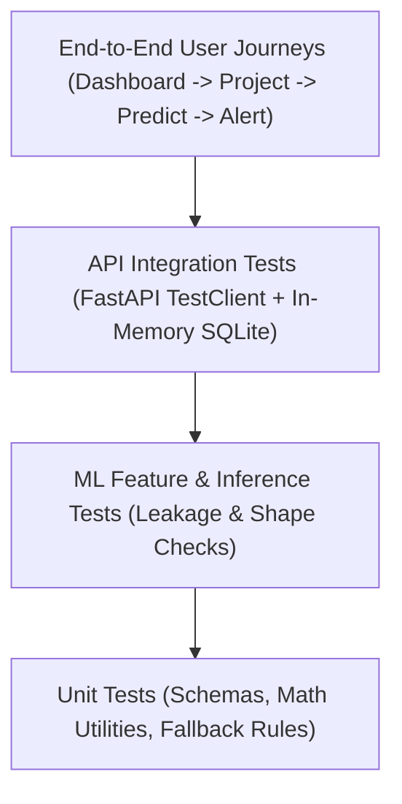

# PAIMANA Testing & Quality Assurance Strategy

---

## 1. Testing Pyramid Overview

The testing strategy ensures correctness across four distinct layers:
1. **Unit Tests (Backend & ML)**: Validate schema validation, calculation logic (velocity ratio, gap score, composite weights), fallback heuristics, and model artifact loaders.
2. **API Integration Tests (FastAPI + TestClient)**: Verify endpoint contracts, HTTP status codes, query filtering, database rollbacks, and error responses.
3. **ML Pipeline Tests**: Guarantee zero data leakage, consistent feature matrix dimensions, probability calibration bounds $[0, 1]$, and deterministic predictions.
4. **Frontend Component & Integration Tests**: Verify UI rendering, KPI cards, filter interactions, alert actions, and graceful error states.



---

## 2. Test Execution Commands

### Backend & ML Tests
```bash
# Run all backend and ML tests with pytest
pytest backend/tests ml/tests -v --durations=5
```

### Frontend Tests
```bash
# Run frontend unit & component tests
cd frontend && npm run test
```

### Type Checking & Linting
```bash
# Python ruff & type check
ruff check backend/
# Frontend TypeScript check
cd frontend && npm run typecheck
```

---

## 3. Critical Test Scenarios & Invariants

| Domain | Invariant / Test Case | Verification Criteria |
| :--- | :--- | :--- |
| **Risk Bounds** | Composite Risk Score must strictly lie in $[0.00, 100.00]$. | Never returns negative or $>100$ under any edge inputs. |
| **Data Leakage** | Feature engineering at cutoff date $T$ must ignore all records with date $> T$. | Automated test asserting future values do not change feature vector. |
| **Missing Model** | If `ml/artifacts/*.joblib` is deleted, API `/risk` must still return valid status. | Returns `200 OK` with `is_fallback: true` and documented rule calculation. |
| **Alert Trigger** | Project with physical gap $>25\%$ and financial burn $>60\%$ must trigger an alert. | Alert service inserts record with `severity: HIGH` or `CRITICAL`. |
| **Tool Calling** | AI assistant must never execute raw arbitrary SQL. | Invocations pass strictly through typed Python tool functions with parameter validation. |
